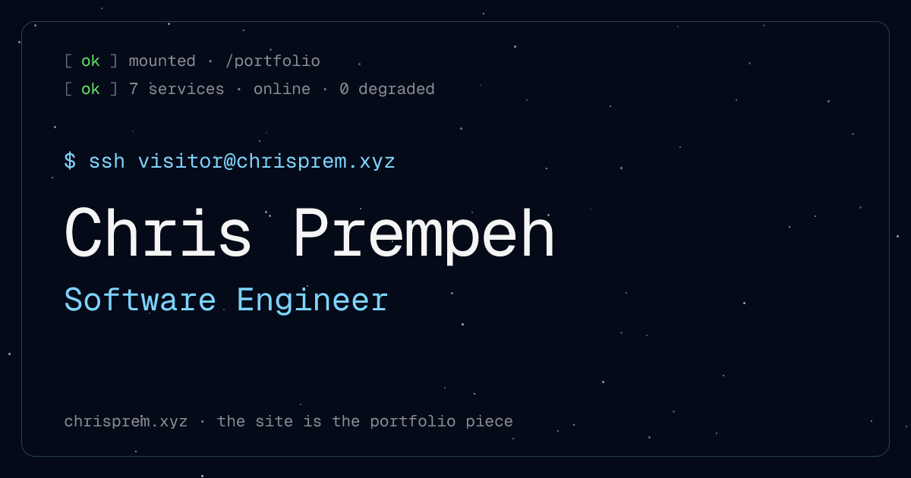

# chrisprem.xyz

**The site is the portfolio piece.** An ops/terminal-themed personal site where the interface itself demonstrates the work: a real interactive shell, draggable architecture diagrams of real projects, live telemetry, and a contact form that is an actual API endpoint.

**Live: [chrisprem.xyz](https://chrisprem.xyz)** · [v1 (previous version)](https://chrisprem.xyz/v1)


<!-- TODO: swap for a full-page screenshot at docs/screenshot.png -->

## What's real (and what's honest about not being)

| Surface | Status |
|---|---|
| Terminal (`help`, `cat`, `sudo hire-me`, tab-complete, history) | Real, fully client-side |
| Contact form → `/api/contact` | **Real**: emails via Resend, honest 503 when unconfigured |
| RTT in the HUD / hero / terminal banner | **Measured** from your browser via `/api/ping` (edge) |
| GitHub activity strip | **Real**: GraphQL contribution data, 1h cache |
| FPS in the HUD | Real, smoothed, hides while warming up |
| Uptime chart + incident story | Synthetic, labeled, and internally consistent (one source of truth: `src/lib/os/uptimeStory.ts`) |
| Latency globe city pins | Representative demo data, labeled as such - plus your own live RTT |

## Features

- **Working terminal**: `ls` / `cd` / `cat` a fake filesystem, `run <project>` to trigger the architecture view, `sudo hire-me` for contact info. Tab completion, ↑/↓ history, ctrl-L.
- **Architecture diagrams**: five real projects rendered as draggable node graphs (Pointer Events, touch included) with per-component notes, code snippets, and source/demo links.
- **Vim command bar**: press `:` (or ⌘P) anywhere: `goto contact`, `project habits`, `replay trace`, `source`.
- **Observability section**: uptime strip, GitHub contribution heatmap, request-trace animation.
- **Latency globe**: three.js globe at [/playground/latency](https://chrisprem.xyz/playground/latency).
- **OG share card**: generated at build time (`src/app/opengraph-image.tsx`), terminal-styled.
- Reduced-motion support throughout; animation loops park themselves when off-screen or idle.

## Stack

Next.js 15 (App Router) · React 19 · TypeScript · vanilla CSS (design tokens in `src/styles/os/tokens.css`) · three.js (globe only, lazy-loaded) · deployed on Vercel.

## Environment variables

All optional - every feature degrades gracefully without its variable.

| Variable | Purpose | Without it |
|---|---|---|
| `NEXT_PUBLIC_SITE_URL` | Canonical origin for metadata/robots/sitemap | Falls back to `https://chrisprem.xyz` |
| `GITHUB_TOKEN` | Classic PAT, `read:user`: powers `/api/github/contributions` | Activity strip shows a profile link |
| `RESEND_API_KEY` | Sending key for `/api/contact` | Endpoint returns an honest 503 with a direct email |
| `CONTACT_EMAIL` | Recipient for contact messages | Defaults to the address in `src/lib/os/links.ts` |

> **Resend free-tier note:** until a sending domain is verified, Resend only delivers to the email address that owns the Resend account - `CONTACT_EMAIL` must be that address.

## Local development

```bash
npm install
npm run dev
```

Optionally copy `.env.example` to `.env.local` and fill in tokens to exercise the real integrations locally.

## Structure

```
src/
  app/                 # routes: / (v2), /v1, /playground/latency,
                       # /api/contact, /api/ping, /api/github/contributions,
                       # opengraph-image, robots, sitemap
  components/os/       # v2 UI: Hero, Terminal, Architecture, Uptime,
                       # GithubActivity, Endpoint, VimBar, Hud
  components/cosmos/   # starfield / shooting stars / cursor effects
  components/v1/       # legacy v1 site (preserved, untouched)
  hooks/os/            # useMeasuredRtt, useFps, useInView, useReducedMotion…
  lib/os/              # links.ts (single source of URLs), uptimeStory.ts, prng.ts
  styles/os/           # tokens, layout, cosmos, animations (vanilla CSS)
```

## Deploy

Pushing to `main` deploys via Vercel (project `man-city1` serves chrisprem.xyz). Set the environment variables above in the Vercel project settings; they take effect on the next build.
